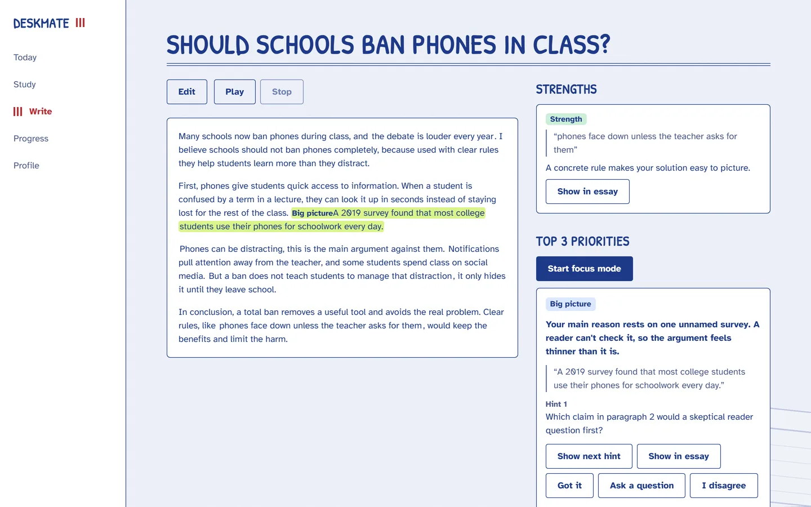
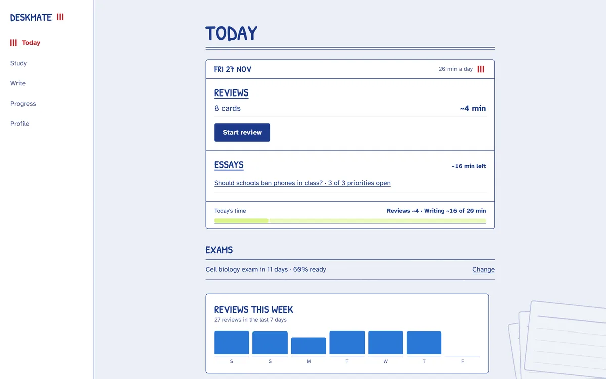
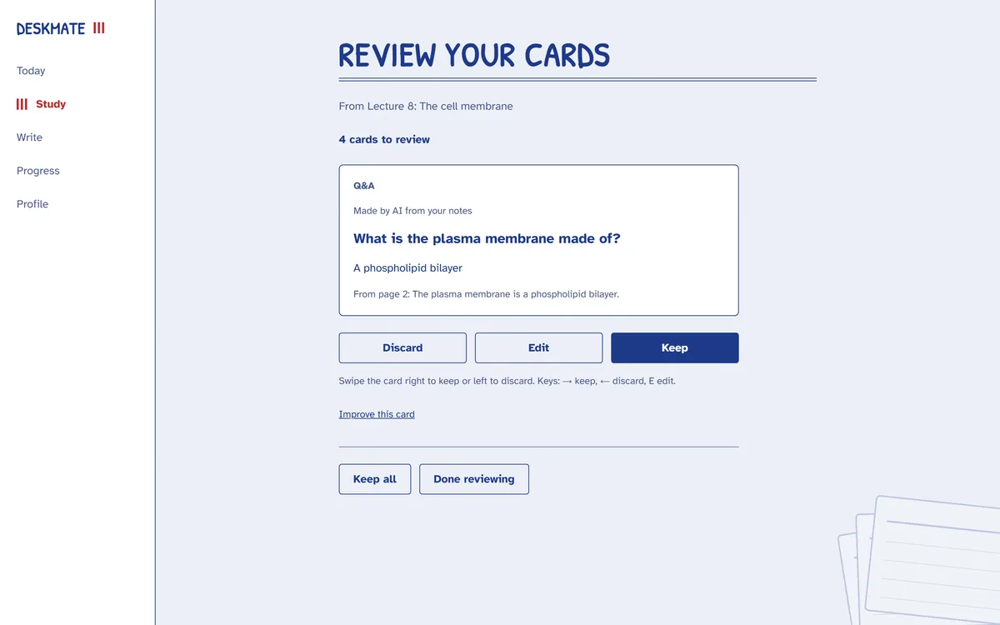
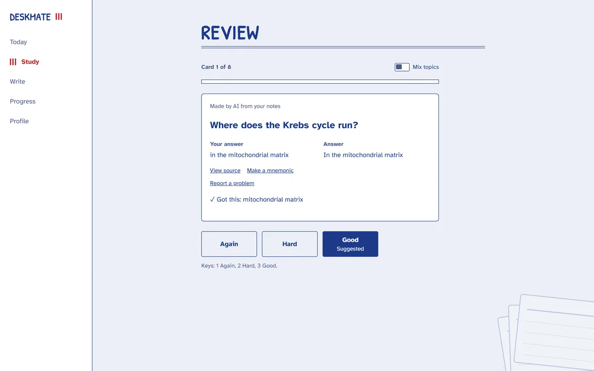
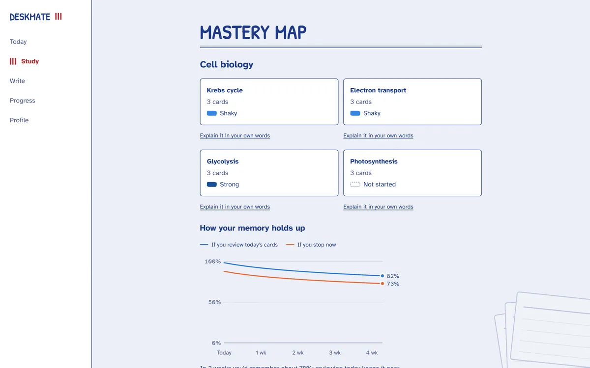
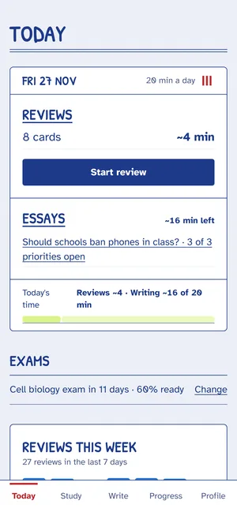
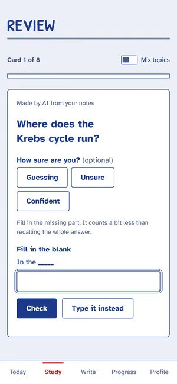

# Deskmate

An AI study app with two tools. **Draft Coach** gives layered feedback on essays and hints before it rewrites. **Recall** turns a student's own notes into flashcards scheduled for their exam date. The AI coaches; the student does the work.

**[Try the live demo →](https://deskmate-demo.onrender.com)** Each visitor gets a fresh sample account. AI features are off in the demo. It runs on free hosting, so the first load can take about a minute.



> **Status:** the demo is live. Production deployment with a custom sign-in email, then a closed beta with college students and exam reviewees, are next. The project was called Scholar before, so the database schema and some code still use that name.

## Walkthrough

*The account and its data are seeded and fictional; no AI call was made for these screens.*

**1. Start with today.** One card for the day: due reviews, open essay priorities, and how the time splits within the student's daily minutes.



**2. Keep the cards worth studying.** Cards the AI made from a lecture wait in triage. Each shows the line of the notes it came from.



**3. Review by typing the answer.** The typed answer is matched for meaning, the key point it got is shown, and a rating is suggested. The student decides.



**4. See what is slipping.** The mastery map groups cards by concept, and the forecast shows what reviewing today is worth before the exam.



**5. Study on the phone.** Built mobile first, with fill-in-the-blank variants and an optional confidence check.

<p>
  
  &nbsp;
  
</p>

## Features

- **Draft Coach:** feedback in three layers (big picture, paragraphs, sentences), ranked into the top three priorities, with strengths, rubric scores and a focus mode
- **Recall:** cards made from PDFs, Word files, slides, photos of notes or an Anki deck, each tied to its source passage and triaged before it's studied
- **Review:** typed answers graded for meaning, FSRS scheduling, an exam-date forecast and a mastery map by concept
- **Today:** one plan for the day that fits the student's chosen minutes
- **Installable PWA** with offline reviews, email and Google sign-in

## Engineering highlights

- **The student does the work:** feedback opens as a question and climbs a hint ladder; a full rewrite is the last level and is capped per draft.
- **Every card is traceable:** each AI-made card keeps the quote and page it came from, and new cards wait for the student to keep, edit or drop them.
- **AI only when needed:** answers are graded by exact and fuzzy matching and on-device embeddings first; the AI grades only what those can't settle.
- **Costs and privacy enforced in the database:** every AI route has a daily cap enforced in PostgreSQL, data is protected by row-level security, and only providers that don't train on inputs serve students.
- **Free-tier LLM router** with per-provider rate limits, measured against an evaluation set that is rerun with a token budget whenever a prompt or model changes.
- **Tested:** 660 unit and component tests (102 files), plus database tests of row-level security and quota functions against the real schema.

## Tech stack

| Part | Technology |
| --- | --- |
| App | Next.js 16, React 19, TypeScript, Tailwind 4, installable PWA |
| Data | Supabase (PostgreSQL, row-level security, Auth), Dexie for offline reviews |
| Learning | ts-fsrs scheduling, Transformers.js embeddings, Tesseract OCR, pdf.js, mammoth, sql.js for Anki import |
| AI | An LLM router over Groq and Mistral (Gemini for evaluation and development only) |
| Quality | Vitest, database tests against the Supabase schema, an LLM evaluation set |

## Run it locally

Requires Node.js 22+ and a Supabase project.

```sh
npm ci
cp .env.example .env.local   # Supabase URL and publishable key, schema "scholar", LLM keys
npm run dev                  # http://localhost:3000
```

Database migrations are in `supabase/migrations/`.

## Tests

```sh
npm test            # unit and component tests
npm run test:db     # row-level security and quota tests against the real schema (needs SUPABASE_* settings)
npm run eval        # LLM router evaluation set
```

## Documentation

- [Deployment](docs/deploy.md) and [public demo](docs/deployment-render-demo.md)
- [Product](PRODUCT.md) and [design system](DESIGN.md)
- [Development notes](docs/dev-notes/): the product brief, the design spec, phase plans, evaluation notes and the progress log
